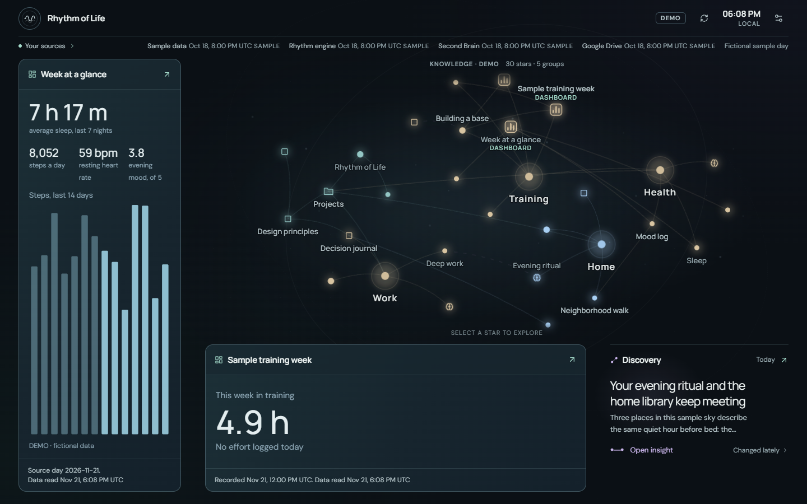
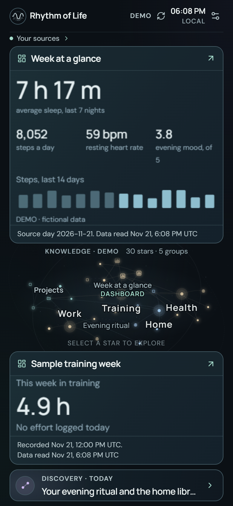

# Rhythm of Life

**A home screen for your household's own data. The AI you already use can read it, build dashboards
on it and leave you one insight a day.**

Point it at a folder of notes, some PDFs and a CSV file of numbers, and they appear as a sky of stars
on a wall screen, a laptop or a phone, with the links between them drawn in. Then connect ChatGPT,
Claude or any MCP client and ask for things: "make a dashboard of our steps and show it on the kitchen
screen". The dashboard is saved as a star of its own, can sit as a card on the home screen, and
redraws from fresh data every time it opens, with no further AI call.

It runs on your own machine with Docker, and your data stays there. By default no language model
runs inside it: your AI stays outside and connects in over MCP, with a token you can revoke.



> **Not a medical device.** Rhythm of Life shows readings from your own devices and services for
> your information only. It does not diagnose, treat or give medical advice, and it must not be
> used to make treatment decisions. Always use your device's own display and your care team for
> those.

> **Alpha** (`0.1.0-alpha.1`). An early release for people comfortable running Docker on their own
> machine. It works and is used daily by one household, but it has had no outside security review,
> and upgrades between alpha versions may need care. Read
> [Before you rely on it](#before-you-rely-on-it) first.

## What you see

A fresh install starts with fictional demo data, all labelled DEMO, so there is something to look at
before you connect anything. The picture above is that demo on a wide display:

- **On the left and along the bottom, dashboard cards.** "Week at a glance" shows average sleep,
  steps, resting heart rate and mood. Touch a card and the whole dashboard opens.
- **In the middle, the sky.** Every note, document, measurement and dashboard is a star. Solid lines
  are links you wrote yourself, such as a wikilink from one note to another. Dashed lines are "similar
  in meaning" links, found by a small embeddings model that runs on your own CPU.
- **At the bottom right, today's insight.** One finding with its sources. You answer it with
  Interesting, Explore, Not useful, Remind me later or Already handled, and your AI can read that
  answer before it writes the next one.

Touch a star to open it: a note rendered, a PDF's pages, a measurement's readings, or a dashboard.
An explorer searches the sky. Every open copy of the app is a screen with a name you can change, such
as "Kitchen iPad", and you or your AI can send things to it.

The demo has no glucose and no Garmin data. Connect Nightscout or Garmin and their tiles appear on
the home screen: the current glucose reading with its last 24 hours, recovery and training.



## What you can ask your AI

A connected client gets 29 tools (30 with `engine.recall: on`; 41 more with `memory.tools: on`). You
ask in plain words and it picks the tools. Some requests they were built for:

| You ask | What happens |
|---|---|
| "What changed in our notes this week?" | It reads the stars that are new or changed and the links first seen since then (`graph_changes`), and follows the links around the ones that stand out (`explore_graph`). |
| "Find the boiler manual. What does it say about servicing?" | It searches your documents by their words (`search_knowledge`) or by meaning (`semantic_search`), and reads the one it found (`get_resource`). |
| "Make a dashboard of Sam's glasses of water and Alex's steps." | It looks at the real data first (`dashboard_data`), writes one page and saves it (`save_dashboard`). The dashboard becomes a star, linked to the data it reads. |
| "Show it full screen on the kitchen screen." | That screen changes within about a second, with a small note saying it came from your assistant and an Undo button (`control_screen`). |
| "Add a button that logs a glass of water." | The dashboard's next version declares that write. Nothing is written until a person turns on Allow edits for the dashboard in the app. |
| "Is Alex's resting heart rate lower after days with more steps?" | The engine pairs the days and answers with the contrast, the counterexamples and, where the data is too thin, `cannot_evaluate` (`evaluate_health_hypothesis`). It is an exploratory comparison and does not establish a cause. |
| "Leave me one insight every morning." | You give your assistant's scheduler [the daily insight prompt](harness/chatgpt/daily-insight.md). Each run saves at most one insight, or logs that the day was quiet. |

These are examples of requests, not transcripts: what an AI does with the tools is up to that AI.

<details>
<summary>The 29 tools, by what they are for</summary>

| For | Tools |
|---|---|
| the map of stars | `explore_graph`, `graph_changes`, `get_relationship_graph` |
| finding and reading | `search_knowledge`, `search_resources`, `semantic_search`, `get_resource`, `get_related_resources` |
| health data | `discover_health_sources`, `read_health_source`, `investigate_health`, `evaluate_health_hypothesis`, `query_health_metrics`, `compare_health_trends`, `get_sync_status` |
| dashboards | `dashboard_data`, `save_dashboard`, `list_dashboards`, `delete_dashboard`, `dashboard_history` |
| insights | `save_insight`, `list_insights`, `log_insight_run` |
| documents | `save_document` |
| screens | `list_screens`, `control_screen` |
| drafting a dashboard live | `studio_dashboard`, `discover_dashboard_controls`, `invoke_dashboard_action` |

[contracts/README.md](contracts/README.md#21-harness-tools-73-tools) has every tool's arguments.

</details>

Memories are a separate feature, off until you turn it on (`memory.tools: on`): your AI can save,
update and recall things across conversations, with history, undo, a trash and a hold for writes
that look suspicious ([harness/memory.md](harness/memory.md)).

## What a dashboard is

One page of HTML that your AI writes, plus the named feeds it reads: a measurement's readings, a
document's contents, the stars around a star, or a log.

- **It stays current without the AI.** The app hands the page fresh feed data on every open and
  every refresh. No AI call is made.
- **It is sandboxed.** The page runs in a sandboxed frame whose content policy blocks every
  request: no fonts, libraries, images or calls to anywhere load from outside.
- **It has a card.** Every dashboard also draws a small card for a corner of the home screen, and a
  tall one for the column on the left.
- **It can sit beside the app's own parts.** A dashboard can be a grid: its page next to the real
  sky, narrowed to the stars the dashboard is about, the health tiles, the insights and other
  dashboards' cards.
- **It keeps its versions.** Each new page is a new version with a note on what changed, and an
  earlier version can be brought back.
- **It writes only when a person allows it.** A dashboard can declare writes, such as an entry in a
  log. They do nothing until someone turns on Allow edits for that dashboard in the app, and the app
  shows each change with Undo.

With Studio, a client drafts a dashboard live on one screen, kept apart from the saved versions until
it is saved.

## What a daily insight is

A finding your AI writes and the home screen shows. The prompt that ships with the project saves at
most one a day. The one in the demo reads:

> **Discovery: DEMO · Longer sleep after walking days**
>
> In the fictional demo data, nights after a day with more steps run a little longer.
>
> Evidence: weak. Limitations: fictional data generated for the demo.

Each insight is a focus, a discovery or a suggestion. It says why it matters and what to do next,
marks each of its points as observed, sourced, inferred or a hypothesis, gives an evidence level and
its limitations, and lists every source it used. Open it and the stars it is about are lit together
in the explorer.

Nothing in the stack writes insights by itself. You paste
[the daily insight prompt](harness/chatgpt/daily-insight.md) into a scheduled task in ChatGPT, or in
any assistant that can run a prompt on a timer with the connector turned on. Each run looks at what
changed, reads your feedback on earlier insights, and either saves one insight or logs a quiet day,
so the app can show that it ran.

## Where your data is

- **On your machine.** A Postgres database, the engine's archive of imported originals, and your
  own notes and import folders, which the engine mounts read-only. Encrypted backups, restore and
  upgrade with rollback are one command each.
- **Nothing leaves on its own.** The engine reaches the internet only for the adapters you connect
  and, once, to download the embeddings model's files (about 23 MB). Building the images fetches
  their base images and packages.
- **No language model inside by default.** That embeddings model is the only model on by default.
  It serves search by meaning and the "similar" links. All reasoning is done by your own AI client,
  outside the stack ([docs/models.md](docs/models.md)).
- **Your AI sees what it reads.** A connected client can read everything in the install, and what it
  reads goes wherever that client runs. Each client has a token of its own, and a revoked token is
  refused on its next call.
- **Closed until you open it.** The app and the MCP endpoint listen on this computer only, until you
  choose a way to reach them from elsewhere.

## Quick start

You need Docker with Compose 2.20 or later, and nothing else. The first start builds the images on
your machine, which takes some minutes, and downloads one small model (about 23 MB). This is an
alpha with no outside security review: read [Before you rely on it](#before-you-rely-on-it) before
you put your own data in.

```sh
git clone https://github.com/pattern-house-creative/rhythm-of-life.git && cd rhythm-of-life
./rhythm init     # a few questions; writes deploy/compose/rhythm.yaml, .env and secrets/
./rhythm up       # builds and starts Postgres, the engine and the app, then prints where to go
```

On Windows PowerShell use `.\rhythm.ps1 init` and `.\rhythm.ps1 up`.

`up` prints three things:

- the app's address, `http://127.0.0.1:8080` by default: open it and the demo sky is there;
- the MCP address for your AI client, `http://127.0.0.1:8181/mcp`;
- the path of a token file to give that client. The token itself is never printed.

Then:

| To do this | Run or read |
|---|---|
| check the install | `./rhythm doctor` |
| see what you can connect | `./rhythm connect` |
| connect ChatGPT, Claude or another MCP client | [Connect your AI](#connect-your-ai), below |
| reach it from other devices | [deploy/exposure/](deploy/exposure/README.md) |
| back it up | `./rhythm backup`, and keep `secrets/backup_password` offline ([docs/backups.md](docs/backups.md)) |
| upgrade | `./rhythm upgrade` ([cli/README.md](cli/README.md#upgrade)) |
| stop it | `./rhythm down` |

[docs/operations.md](docs/operations.md) is a full first walk on sample data: the install, the app, an
AI client, memories, a backup, a restore and an upgrade.

## Connect your AI

A client needs three things: the MCP address, the Streamable HTTP transport, and a token as a Bearer
header. The first `up` made a token named `assistant`. With Claude Code on the same computer, from
the repository root in sh:

```sh
claude mcp add --transport http rhythm http://127.0.0.1:8181/mcp \
  --header "Authorization: Bearer $(cat deploy/compose/secrets/harness_assistant_token)"
```

Ask it to list the tools it has from Rhythm of Life, then to call `list_insights`. It should find the
DEMO insight.

| Client | How it connects |
|---|---|
| Claude Code, and editors that take a URL and headers | directly ([harness/generic-mcp/](harness/generic-mcp/README.md)) |
| Claude Desktop | through a small stdio bridge ([the same page](harness/generic-mcp/README.md#3-claude-desktop-and-other-clients)) |
| Claude on the web, desktop or mobile, as a custom connector | from Anthropic's servers, so it needs a public HTTPS route in, and an account that offers request headers ([claude-hosted.md](harness/generic-mcp/claude-hosted.md)) |
| ChatGPT | from OpenAI's servers, so it needs a route in: OpenAI's Secure MCP Tunnel or Cloudflare ([harness/chatgpt/](harness/chatgpt/README.md)) |

Rhythm has bearer tokens only for now, so a hosted connector that accepts only OAuth cannot connect
yet. Give each client a token of its own with `./rhythm token create <name>`, so you can revoke one
without touching the others.

## Your own stars

Your own things need no account anywhere.

- **Notes:** `./rhythm init --notes <folder>` points the `notes` adapter at a folder of Markdown notes.
  An Obsidian vault works as it is. Wikilinks, folders and tags become links and projects
  ([notes](docs/adapters/notes.md)).
- **Numbers:** CSV files in the import folder become data stars: weight, steps, blood pressure,
  glasses of water, anything a device or a spreadsheet can export ([csv](docs/adapters/csv.md)).
- **Documents:** PDFs, text and Markdown, added in the app or dropped in the import folder's
  `documents/` folder, open in the reader as themselves ([documents](docs/adapters/documents.md)).

### Try it

To try all three with the fictional samples in `demo/`:

```sh
./rhythm init --notes ../../demo/notes     # paths in .env start at deploy/compose/
# then set RHYTHM_IMPORT_DIR=../../demo/import in deploy/compose/.env
./rhythm up
```

## Optional connections

Each is off until you connect it with `./rhythm connect <adapter>`; [docs/](docs/README.md) has a page
for each.

| Adapter | Brings |
|---|---|
| Nightscout | a live glucose feed: the current reading, the last 24 hours and a 14-day panel |
| Garmin | sleep, heart rate, steps and activities, from a Personal API key or exported files |
| Google Drive | your documents, and live Sheets and Docs for dashboards (your own Google Cloud project) |
| Calendar | private calendar links |
| Second Brain | memories from a hosted Second Brain service, read by reference or imported |
| Titles | short titles for stars from a local model (Ollama) |
| [CareLink plugin](docs/adapters/carelink.md) | a separate, optional, unofficial plugin; not published yet |

Ways to reach an install from elsewhere: [Tailscale](deploy/exposure/tailscale/README.md),
[Cloudflare Tunnel and Access](deploy/exposure/cloudflare/README.md),
[OpenAI's Secure MCP Tunnel](deploy/exposure/openai-tunnel/README.md) for ChatGPT, a
[reverse proxy](deploy/exposure/reverse-proxy/README.md), and a [TrueNAS guide](deploy/truenas/README.md).

## Before you rely on it

This is an alpha. [docs/known-limits.md](docs/known-limits.md) is the whole list; these are the ones
to know before you install.

- **No outside security review.** The code has been reviewed by its authors only.
- **There is no login inside Rhythm of Life, and the household shares everything.** Everyone you
  list in an install sees all of its data. Who can reach it at all is decided by where it listens:
  this computer only (the default), your home network, Tailscale, Cloudflare Access, or your own
  reverse proxy. [docs/security.md](docs/security.md) explains the model and what never to expose.
- **Alpha upgrades may need care.** Database migrations only go forward. `./rhythm upgrade` takes a
  backup first, and a failed upgrade rolls the images back, not the database.
- **Images are built on your machine.** There are no published images yet.
- **Backups are yours to schedule and copy.** `./rhythm backup` makes an encrypted backup on the same
  machine. Nothing copies it elsewhere.

**How far these are tested.** The core (notes, CSV, documents, MCP, backup, restore, upgrade) is tested
end to end on real stacks with fictional data. The Tailscale, Cloudflare, Google, Garmin and TrueNAS
steps are checked against fakes and `docker compose config` only, and the OpenAI tunnel against a local
stack cut off from the internet; none against real accounts or hardware. Treat an exposure recipe as a
starting point and check what it exposes yourself.

## How it fits together

```
 your AI: ChatGPT, Claude, any MCP client        a browser: wall screen, laptop, phone
              |                                                |
              |  MCP, one token per client                     |
              v                                                v
        +-----------+                                 +----------------+
        |  engine   | <------------------------------ |  app's server  |
        +-----------+                                 +----------------+
          |       |
          v       v
      Postgres   adapters: notes, CSV, documents, and the optional ones
```

| Part | What it is |
|---|---|
| **app** | an installable web app (PWA), with a small server that is the only thing talking to the engine |
| **engine** | a .NET service on Postgres with pgvector: the catalog of everything you connect, the relationship graph, dashboards, insights and one MCP endpoint |
| **adapters** | every outside service is an optional, replaceable adapter |
| **your AI** | outside the stack, connecting to the engine's `/mcp` with its own token |

## Documentation

| Read | For |
|---|---|
| [docs/operations.md](docs/operations.md) | running an install: the first walk, every setting that is off by default, limits, what runs on its own |
| [docs/configuration.md](docs/configuration.md) | every setting in `rhythm.yaml` and `.env`, and every secret file |
| [docs/security.md](docs/security.md) | who can see what, tokens, and what never to expose |
| [docs/backups.md](docs/backups.md) | backups, the restore drill, recovering on a new machine |
| [docs/known-limits.md](docs/known-limits.md) | what this alpha does not do yet, and risks to know about |
| [cli/README.md](cli/README.md) | every `rhythm` command |
| [harness/](harness/README.md) | connecting AI clients, the daily insight template, session hooks |
| [contracts/README.md](contracts/README.md) | the app, MCP, adapter and plugin contracts |
| [docs/dev/](docs/README.md#contributors) | how the engine, memories, screens and Studio work inside |

## Repository layout

```
app/         the web app and its server
apps/        the Android launcher, a development build (apps/android-launcher)
engine/      the knowledge engine, adapters, migrations, tests
contracts/   app to engine contract, MCP tools, adapter and plugin contracts, JSON Schemas
deploy/      compose (the only required deployment), TrueNAS, Vercel and exposure recipes
harness/     connecting ChatGPT, Claude or any MCP client
demo/        fictional seed data
cli/         the rhythm command's guide and end-to-end tests
docs/        configuration, adapters, security, backups and contributor docs
scripts/     repository checks and their tests
```

## Contributing and security

- Changes are welcome: start with [CONTRIBUTING.md](CONTRIBUTING.md) and the
  [Code of Conduct](CODE_OF_CONDUCT.md).
- Found a security problem? Please report it privately: [SECURITY.md](SECURITY.md).
- What changed in each version: [CHANGELOG.md](CHANGELOG.md).

## Licence

[Apache License 2.0](LICENSE). Copyright 2026 Rhythm of Life contributors. See [NOTICE](NOTICE) for
what was adapted from other projects, and the [third-party licence inventory](docs/licenses/README.md).

Garmin, Nightscout, Google, Tailscale, Cloudflare, OpenAI, ChatGPT, Claude, Obsidian, TrueNAS,
CareLink, Medtronic, SmartGuard, IRONMAN, Docker, Ollama and PostgreSQL are names of their owners'
products. Rhythm of Life is not affiliated with or endorsed by any of them.
