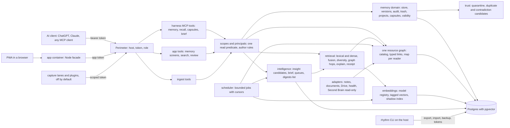
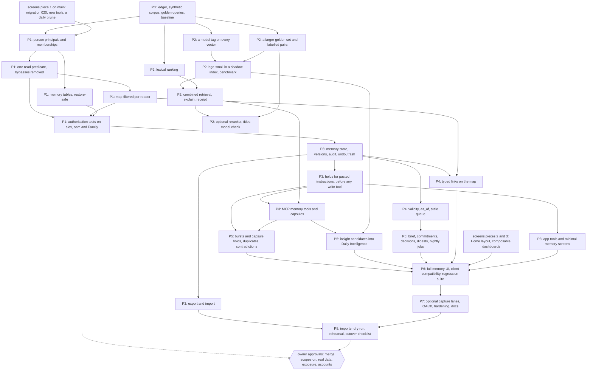

# Target architecture

Where the program takes Rhythm, phase by phase, and what each part depends on. The decisions behind it are in
the program's decision log; the work items in the program's backlog.

## Today

- **One engine, one database.** The .NET engine (`engine/src/Core/`) keeps a catalog of resources (`resources`), their
  links (`relationships`), measurements, insights and dashboards in Postgres with pgvector. Adapters (notes, documents,
  CSV, Drive, Garmin, Nightscout, titles, and Second Brain by reference) feed it.
- **Three doors, one perimeter.** `Mcp/Perimeter.cs` checks the host, the bearer token and its role, then hands the call
  to the harness MCP server (AI clients, 26 tools), the app endpoint (`app_*` tools for the PWA's Node facade, one app
  principal) or the ingest endpoint (plugins, scoped to their providers).
- **One shared map.** A scheduled rebuild (`Core/RelationshipHost.cs`, `Core/RelationshipEngine.cs`) builds one snapshot
  of stars and links as the system principal and serves it to every reader.
- **The household shares everything.** `Database.Allowed` lets every enabled harness, app and system principal read
  every subject's rows; four read paths skip even that check (`docs/security.md`, the parity ledger SEC-03,
  SEC-06).
- **Memories are read, not owned.** Second Brain memories are stars by reference; their text is fetched on open and never
  stored. Rhythm has no memory store, history, trash or memory tools of its own.

## Target

### Native memories are a domain inside the engine

- Memory tables arrive by numbered migrations from 021 (D-003): memories (scope, subject, author, kind, status,
  importance, volatility, source, tags, project, validity window, revision), their versions, an insert-only audit trail,
  the trash, projects with aliases, capsule revisions. Later phases add insight candidates, job cursors, push
  subscriptions and the opt-in recall log.
- Each memory also has an ordinary `resources` row, so the map, dashboards, pins and `get_related_resources` see it like
  any other star, with a stable graph id derived from the memory id. Its text lives in the memory tables, never in a
  snapshot row, which a restore blanks (the parity ledger RHY-18).
- Writes go through role- and scope-checked database functions, the pattern `save_document()` already uses (017), with
  an expected revision (optimistic concurrency) and an idempotency key (the `ingest_calls` pattern).
- Memory passages are chunked into the existing `resource_chunks`, model-tagged, so search reaches them.
- The Second Brain adapter keeps reading, unchanged and read-only, beside native memories until the owner decides
  otherwise (phase 8).

### Scopes and principals

- People are already `subjects` (person, household). A principal (a harness token, a future app session) is bound to one
  person; the household is the shared scope, shown as Family; memberships say who belongs to it.
- One read predicate, used by every read path: the caller's private scope plus the shared scope. The four reads that skip
  today's predicate move onto it. The map is filtered per reader at read time; vectors, excerpts and neighbours of a
  private memory never reach anyone who can't read it.
- Edits: a private memory by its owner; a shared one by its author or an admin. Link, unlink, project and insight
  actions follow the same rule (D-031).
- Modes: an existing install keeps the household model (`scopes` off) until its owner switches; with scopes off, a
  native memory is a household memory and the reply says so, and no personal import is allowed. A switch never widens
  what anyone sees (D-012, D-013).
- The app gets an opt-in, server-side viewer identity mapped to a person principal; no bearer token ever reaches the
  browser (D-011, D-046). Until it is on, the app shows only household-visible memory data.

### One resource graph

- Every link stays in `relationships`. The map rebuild keeps its engine tag (`cross-source-v1`); links people and AI
  clients make get their own engine tag, so a rebuild never retires them, and the map's read path includes them.
- Upstream's edge types join Rhythm's (D-030), with provenance mapped onto Rhythm's verification: a person's link is
  verified, an AI's or a job's is inferred or suggested (D-015). A link needs both ends in scopes readable by the same
  people; two people's private records never link.
- Changing or deleting an endpoint invalidates derived links and cached excerpts; a person-made link is never deleted
  automatically, only reported when broken.

### Retrieval and models

- One combined path improves the existing tools rather than adding a service: ranked full text (with exact-id boosts)
  and model-tagged vectors, fused by reciprocal rank, filtered by scope, status, project, tag, kind, time and validity,
  diversified, optionally expanded along typed links and optionally reranked, then cut to a budget with reasons and a
  receipt. With vectors off it falls back to full text and says so. A switch restores the old tools' behaviour.
- Every stored vector names its model and revision. A new model fills a shadow index; vectors of different models are
  never compared; the old model stays until the new one passes the gate (D-025). The titles model is assessed on its
  own (D-027).

### One insight stream

- The engine finds candidates (old and new memories alike, not yet linked, not recently cited) with a bounded nightly
  job. The AI client's daily insight task reads them, writes at most one insight citing its sources or declines, and
  logs the run. The app shows that one stream, with proposed and confirmed kept apart (D-018).
- The brief, open loops, commitments, decisions, stale facts and pending insights each come from one predicate, used by
  its count, its list and any card.

### MCP is the AI boundary

- One MCP server. Memory tools take upstream's names and shapes where safe (D-030), with input and output schemas,
  `isError` on failure, read-only and destructive hints, and replies framed as data. Capsules are both a tool and an
  MCP resource.
- No large model runs inside the stack (D-020, D-033): the engine returns candidates and records decisions; the AI client
  reasons.

### Portable by default

- `rhythm init` and `rhythm up` start the whole stack with no vendor service: no hosted front end, tunnel, Cloudflare,
  OpenAI or Second Brain account is needed. Model files are optional downloads; without them search falls back to full
  text.
- Backups (`rhythm backup`) cover the memory tables; `rhythm export` and `rhythm import` move memories with their ids,
  scopes, authors and histories (D-035).

## Phases and what they depend on

Phases run in order (the program plan's section 4). Items in phase 2 that touch no memory data (model tags, lexical
ranking, the benchmark) may start beside phase 1; nothing that stores a private memory starts before phase 1 exits.

The owner moved SB-P7-01, with SB-P7-02 and SB-P7-11, ahead of phase 6's exit (D-221): that arrow was ordering, not
technical. It holds for the rest of phase 7.

## Shared files and the screens program

The screens program (live screens and composable dashboards) is changing the same repo now. It owns the screens
commands and tables (`engine/src/Core/Screens*`, migration 020), dashboard composition (`engine/src/Core/Dashboard*`,
`app/src/Dashboard*`, `app/src/dashboards.ts`), the Home layout and tiles, and `docs/dev/screens.md`. This program
owns native memories, scopes and principals for memory, embeddings and model tags, retrieval and ranking, relationships
and graph intelligence, insights, the Second Brain adapter, the titles-model evaluation, and this folder.

| Shared file | This program's change | Phase | Screens' change there | Rule |
|---|---|---|---|---|
| `engine/migrations/` | 021 on: principals and memberships, memory tables, link engine, insight candidates, job cursors | 1 to 5 | 020: `screens`, `screen_commands` | numbers agreed between the two programs, after 020; applied files never edited; no person or home time zone named |
| `engine/src/Core/Mcp/HarnessTools.cs`, `ToolText.cs` | memory tools, `recall`, capsules, brief | 2, 3, 5 | `list_screens`, `control_screen` (24 to 26 tools) | rebase the tool count on `main` after screens lands; additive |
| `engine/src/Core/Mcp/AppEndpoint.cs` | memory, search and review app tools | 2, 3, 6 | `app_screens` | additive |
| `engine/src/Core/Program.cs` | capsule resource, `/health` version and models | 2, 3 | in screens piece 1's file list | additive; items that edit it wait for screens piece 1 on `main` (SB-X-01) |
| `engine/src/Core/Scheduler.cs` | bounded nightly jobs | 2 to 5 | a daily prune | one guarded job each; additive |
| `engine/tests/Knowledge.Tests/CoreTests.cs`, `Schemas.cs` | tool contract array and memory schemas | 2, 3 | screens tools and schema | rebase on `main` |
| `engine/tests/Knowledge.Tests/DatabaseTests.cs` | as little as possible: scope and memory tests go into new test files | 1 to 5 | screens tables | prefer new files |
| `engine/tests/Knowledge.Tests/Knowledge.Tests.csproj` | copy synthetic fixtures to the test output (claimed for phase 0) | 0 | none | additive |
| `contracts/`, `scripts/contracts.test.mjs` | memory tool schemas and fixtures; an insight fixture per source kind | 3, 5 | `app_screens` schema and fixtures | additive; items that edit them wait for screens piece 1 on `main` (SB-X-01) |
| `app/server/engine.ts`, `app/server/routes.ts` | memory routes and tool names | 3 | screens route, its 35 s limit | additive |
| `app/src/apiClient.ts`, `liveGraph.ts`, `model.ts`, `knowledge.ts`, `graphView.ts` | memory calls, typed edges, search results | 2 to 4 | screens hook and runner | additive |
| `app/src/App.tsx`, `Explorer.tsx`, `Details.tsx` | entry points for memory screens, search, the brief card, model status | 3, 5, 6 | Home layout, "Show on…" | Home belongs to screens: agree any Home change with the screens work first |
| `docs/README.md` | one link to this folder | 0 | its own link (added on `main`) | each on its own line |
| `docs/dev/engine.md`, `docs/security.md`, `docs/configuration.md` | scopes, memory settings, the login-rights note, new questions | 1 onwards | screens' entries | additive |
| `README.md`, `harness/` | tool counts, memory instructions, the daily insight's candidates | 3, 5, 6 | tool counts | rebase on `main` |
| `NOTICE` | upstream attribution | the first adaptation | none | additive |
| `deploy/compose/` | none expected; model folder settings if phase 2 needs them | 2 | none | additive |

Files the screens program owns that this program's items touch, so each needs the screens program's agreement on the
board first:

- `engine/src/Core/DashboardFeeds.cs`: one of the four read paths that skip the read predicate (SB-P1-04), and the
  scope on dashboards (SB-P1-06).
- The `control_screen` commands `open_star` and `search` (`docs/dev/screens.md`): they report star titles to whoever sends
  them, so they must respect private stars once scopes are on (SB-P1-15).
- The Home layout: a brief card (SB-P5-08) and a resurfaced-memory card (SB-P5-17) live there.
